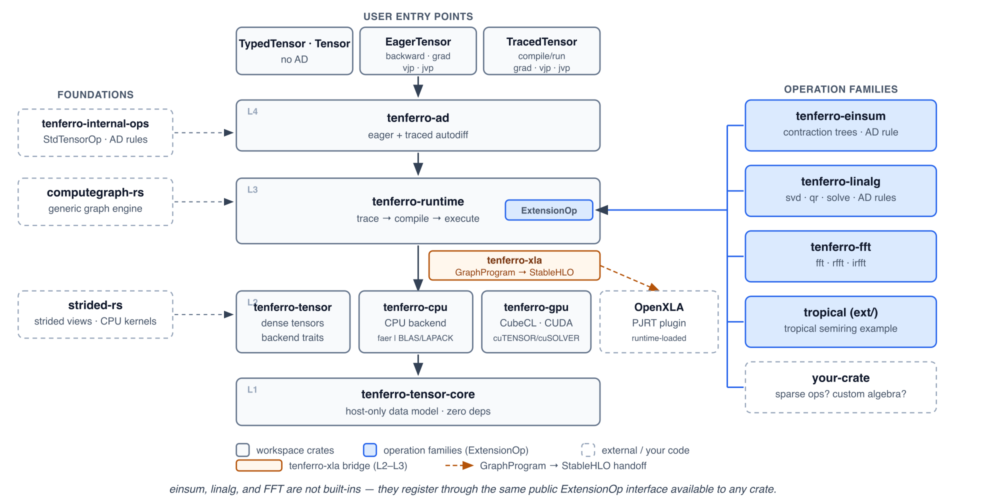

# Summary

`tenferro-rs` is a Rust-native dense tensor computation stack for scientific
workloads. It provides typed and dynamically typed tensors with column-major
storage, explicit CPU and CUDA backends with an experimental WebGPU backend,
linear algebra (SVD, QR, eigendecomposition, LU, solve), einsum with contraction
order optimization, FFT, and opt-in automatic differentiation (AD). AD is
available in two modes: an eager mode with a PyTorch-style `backward()` and a
traced mode in which a program is recorded once and transformed into
vector-Jacobian products (VJP), Jacobian-vector products (JVP) and their
compositions, in the style of JAX. Operation families and their derivative
rules live in separate crates rather than inside one monolithic tensor type, so
downstream projects can add operations without modifying the core.
`tenferro-rs` is the engine under the tensor4all stack for tensor cross
interpolation and quantics tensor trains [@tensor4all-rs; @Ritter2024;
@NunezFernandez2025], and is published on crates.io as a set of independent
crates.

{#fig:arch}

# Statement of need

Tensor network methods, quantum many-body solvers, lattice field theory and
related numerical work increasingly need three things at once: dense tensor
algebra with LAPACK-class linear algebra, automatic differentiation, and
explicit control over where data lives. In Python this need is served by
PyTorch and JAX [@pytorch; @jax]; in Julia by ITensors, TensorOperations and
OMEinsum with Zygote or Enzyme for AD [@itensor; @omeinsum]. Rust has strong
building blocks (`ndarray` for arrays, `faer` for dense linear algebra, `burn`
and `candle` for deep learning) [@ndarray; @faer; @burn; @candle], but no layer
that combines them into a scientific tensor stack. Projects that want Rust for
its ownership model, its build system and its suitability for compile-time
verification have therefore had to bind to C++ or Python runtimes, which
reintroduces the runtime dependency they wanted to avoid.

A second gap is shape dynamism. Adaptive algorithms such as tensor cross
interpolation, truncated SVD sweeps and iterative solvers produce tensors whose
sizes are only known at run time. Trace-and-compile frameworks that assume
static shapes must recompile on every new shape or fall back to eager
execution, losing program transformations. `tenferro-rs` records traced
programs with symbolic shape metadata so that a compiled program is reused
while ranks, truncation sizes and iteration counts resolve at execution time,
with VJP and JVP available throughout.

The target users are researchers writing numerical libraries in Rust, and
users of other languages who reach the stack through a C API, as
`Tensor4all.jl` does [@Tensor4all-jl].

# State of the field

Table 1 summarizes the comparison. `ndarray` offers n-dimensional
arrays but no AD, devices or LAPACK-class decompositions with derivatives.
`faer` is a high quality dense linear algebra library and is used by
`tenferro-rs` as its CPU linear algebra backend. `burn` and `candle` are
deep-learning frameworks: row-major, oriented towards neural network layers,
and without SVD or eigendecomposition derivative rules and column-major
interoperability with Fortran, Julia, MATLAB and LAPACK. In Julia, `OMEinsum`
pioneered einsum with contraction order optimization and generic algebras, and
`ITensors` provides a full tensor network toolkit; both depend on the Julia
runtime. PyTorch and JAX are the reference points for eager and traced AD, and
`tenferro-rs` deliberately follows their user-facing conventions, but they
cannot be embedded in a Rust project without a Python or C++ runtime.

We chose to build rather than contribute to an existing Rust crate because the
missing properties (column-major storage, dynamic-shape traced programs,
explicit device control, AD rules living outside the tensor type) are
architectural and would not have been accepted as incremental changes to a
deep-learning framework. Where a component existed we used it as a backend:
`faer` for CPU linear algebra, CubeCL for GPU kernels [@cubecl], `omeco` for
contraction order optimization, and the StableHLO `dot_general` primitive as
the contraction vocabulary [@stablehlo]. The provenance of every component is
recorded in the repository's provenance and citation policy.

Table: Feature comparison with related libraries. TN means tensor network.

| Library | Language | Storage | AD | Linalg AD rules | GPU | Dynamic-shape trace |
|---|---|---|---|---|---|---|
| tenferro-rs | Rust | column-major | eager + traced | SVD, QR, eigh, LU, solve | CUDA, WebGPU (exp.) | yes |
| ndarray | Rust | row/col | no | no | no | n/a |
| burn, candle | Rust | row-major | eager (burn: traced) | partial | CUDA, wgpu, Metal | no |
| PyTorch | Python/C++ | row-major | eager (+ compile) | yes | CUDA, others | limited |
| JAX | Python | row-major | traced | yes | CUDA, TPU | no (recompile) |
| OMEinsum, ITensors | Julia | column-major | via Zygote/Enzyme | partial | CUDA | n/a |

# Software design

`tenferro-rs` is a workspace of small crates (\autoref{fig:arch}). The core
defines tensor storage, dtype tags and views. Backends (`tenferro-cpu`,
`tenferro-gpu`) implement a fixed backend contract; a backend is constructed
once and passed explicitly, and it owns a buffer pool, so allocation cost is
amortized across calls. Operation crates (`tenferro-linalg`,
`tenferro-einsum`, `tenferro-fft`) register primitives, their shape and dtype
inference, and their derivative rules through an extension macro. The AD crate
implements reverse mode by linearize-then-transpose [@Radul2023], which gives
VJP, JVP, Hessian-vector products and their compositions from one set of
forward rules. The same operations run eagerly for exploratory code and traced
for reusable programs. There is intentionally no facade crate: users depend on
the crates they need.

Two trade-offs deserve mention. Column-major storage matches Fortran, Julia,
MATLAB and BLAS conventions and makes the C API a zero-copy boundary, at the
cost of a mental switch for users coming from NumPy. Explicit backend
arguments make code more verbose than implicit global dispatch, but they
rule out silent host-device transfers and make performance behaviour
inspectable.

Correctness and performance are checked from outside the library. Derivative
rules are validated against a standalone oracle database generated with
PyTorch and independent finite differences [@tensor-ad-oracles]. Performance is
tracked in a separate benchmark repository [@tenferro-benchmark] whose reports
record hardware, thread counts and the BLAS provider of every framework.
\autoref{fig:bench} shows the current state. On CPU with four threads and a
shared Accelerate BLAS, tenferro trace mode is within a factor of two of
PyTorch and JAX on all nineteen einsum instances, ahead on multi-tensor
network contractions and behind on small matrix products where per-call
overhead dominates. On an NVIDIA RTX 3060 in double precision, tenferro and
PyTorch are within a few percent of each other on dense linear algebra, and
tenferro is faster on an f32 tensor network contraction and on several
linear algebra VJP and JVP benchmarks. Because the numbers move with each
release, the paper reports the snapshot and the benchmark repository remains
the canonical source.

{#fig:bench}

# Research impact statement

`tenferro-rs` was made public in February 2026 and has had continuous
development since, with more than 1500 commits, five tagged releases and four
human contributors. It is the execution engine of `tensor4all-rs`, the Rust
implementation of tensor cross interpolation, quantics tensor trains and tree
tensor networks, which is exposed to Julia users through `Tensor4all.jl`
[@tensor4all-rs; @Tensor4all-jl]. Independent projects built on it include a
Rust quantum circuit simulator (Liu, released October 2026), a GPT-2 inference
implementation [@slope-rs], and a Rust port of LatticeQCD.jl for lattice gauge
theory [@latticeqcd-rs]. The library was announced in the tensor4all blog
[@Shinaoka2026blog], featured in Scientific Computing in Rust Monthly
[@scirust-monthly], and discussed on the Rust users forum and Hacker News.
The crates have been downloaded from crates.io several thousand times since
June 2026.

# AI usage disclosure

`tenferro-rs` was developed with AI coding agents (Claude Code by Anthropic,
Codex CLI by OpenAI, and OpenCode; versions TODO) used for code generation,
test writing, refactoring, documentation and issue triage under human
direction. All generated code was reviewed by the maintainers and is gated by
continuous integration, per-file coverage thresholds, derivative oracles held
in a separate repository, and the reproducible benchmark suite. The repository
rules that agents must follow are public in `REPOSITORY_RULES.md` and the
shared `tensor4all-agent-rules`. This paper was drafted with Claude Code
(Claude Fable 5.1) from the repository's documentation and benchmark reports
and was revised and verified by the authors.

# Acknowledgements

We thank Selina Dirnböck, Markus Frankenbach and Nepomuk Ritz for their
contributions to the surrounding tensor4all stack during their stay at Saitama
University, and the maintainers of faer, CubeCL and strided-rs. H.S. was
supported by JSPS KAKENHI (grant numbers TODO) and the JSPS-FWF bilateral
program.

# References
